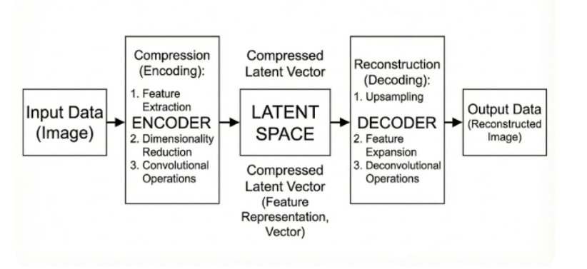
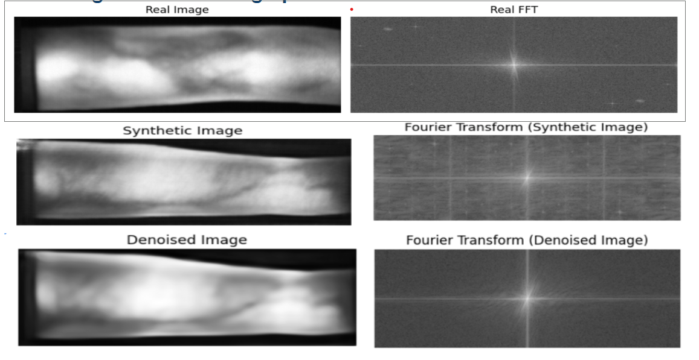

# Autoencoder-Based GAN Fingerprint Removal and Addition

This subproject explores convolutional autoencoders as a way to study and manipulate
model fingerprints in GAN-generated finger-vein images. The motivation comes from
presentation-attack detection (PAD): synthetic-image artifacts can dominate frequency
features and affect how a PAD classifier behaves when synthetic data are used to
augment or replace real training samples.

The autoencoder is intended to learn image structure through an encoder, a compact
latent representation, and a decoder. Because learned reconstruction can behave like
a nonlinear denoiser, the project investigates two complementary training strategies:
one for **removing** GAN fingerprints and one for **adding** them.

## Two training strategies

### 1. Train on real images, apply to synthetic images: fingerprint removal

Train the autoencoder using real, bona fide images and a reconstruction objective. The
model learns the image patterns represented in the real-image training set. Apply this
model to GAN-generated images to reconstruct them while suppressing synthetic
fingerprint artifacts that are not represented by the real-image distribution.

**Goal:** reduce GAN-specific artifacts in synthetic images while preserving their
visible finger-vein structure. The resulting images can then be compared in the
frequency domain or used in downstream PAD experiments.

### 2. Train on synthetic images, transfer artifacts to real images: fingerprint addition

Train the autoencoder on synthetic images so that it learns their recurring structures
and artifacts. Use the learned artifact representation in a subsequent transfer or
inpainting step to add those artifacts to real images.

**Goal:** create real-looking images with controlled GAN-like fingerprints, enabling
experiments on how synthetic artifacts affect image analysis and PAD systems.

This addition direction is conceptually distinct from simply passing a real image
through an ordinary autoencoder. The artifact must be isolated or otherwise represented
and then transferred into the real image; reconstruction alone does not guarantee that
the model has separated the fingerprint from image content.

## Model

The convolutional autoencoder in `src_code/auto_encoder.py` uses four encoder stages
with convolution, normalization, nonlinear activation, and downsampling. A convolutional
bottleneck processes the latent features; the decoder upsamples and reconstructs a
single-channel image. The output is resized when necessary to match the input
dimensions.





The training scripts use grayscale images normalized to `[-1, 1]` and split the
configured image collection into training and validation sets. They optimize
reconstruction losses that combine pixel-level and structural similarity; one variant
also includes a spectral loss. Model checkpoints and sample reconstructions are saved
to configured output directories.

## Code map

- `src_code/auto_encoder.py` — convolutional autoencoder architecture.
- `src_code/model_training.py` — reconstruction training with pixel, structural, and
  spectral loss components.
- `src_code/model_training_spatial.py` — reconstruction training with pixel and
  structural similarity losses.
- `src_code/model_denoising.py` — loads a trained checkpoint and applies it to a
  configured image folder, currently set up as a synthetic-image denoising example.
- `src_code/disp_fft.py` — compares real, synthetic, and processed images in the
  Fourier domain.
- `src_code/fourier_feature_extraction.py` and `src_code/classifier.py` — extract
  frequency features and evaluate PAD training scenarios.

## Running experiments

The scripts currently contain machine-specific dataset, checkpoint, and output paths.
Before running them, update those paths to your local data and create the required
output directories.

1. Install the dependencies used by the selected scripts, including PyTorch,
   torchvision, Pillow, and `pytorch-msssim`.
2. Configure the training data and checkpoint/output paths in the selected script under
   `src_code/`.
3. Train a model, for example:

   ```bash
   python src_code/model_training.py
   ```

   Or use the spatial-loss variant:

   ```bash
   python src_code/model_training_spatial.py
   ```

4. To apply a trained model to images, update the checkpoint, input, and output paths
   in `src_code/model_denoising.py`, then run:

   ```bash
   python src_code/model_denoising.py
   ```

The supplied denoising script demonstrates inference on synthetic images. The
synthetic-trained artifact-addition direction requires an artifact-transfer or
inpainting step; the reconstruction training scripts alone do not implement that
transfer automatically.

## Evaluation

Compare the original and processed images for both visual structure and frequency
content. The feature-extraction and classifier scripts can then be used to investigate
how processing affects PAD performance when synthetic samples are added to, or used to
replace, real samples. Interpret results alongside image-quality measures so that
artifact suppression or addition is not mistaken for a useful transformation if it
also substantially distorts the underlying image.
